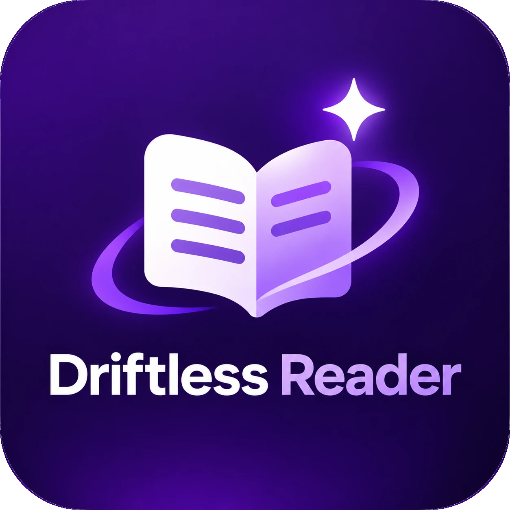

<p align="center">
  
</p>

# Driftless Reader

An open-source **Microsoft Edge and Chrome extension** that helps people with ADHD stay with an article from start to finish.

Most reading tools change how text _looks_. Driftless Reader focuses on what actually breaks reading for many ADHD readers: **drifting away halfway through** and losing your place.

## v1 features

| Feature                          | What it does                                                                                                                       |
| -------------------------------- | ---------------------------------------------------------------------------------------------------------------------------------- |
| 🧭 **Drift Guard**               | Notices when you switch tabs, go idle or skim-scroll, and welcomes you back with the last sentence you read and a _Rewind_ button. |
| ⚓ **Anchor marker**             | Marks the last paragraph you actually read, saved per page, so getting back takes a second.                                        |
| 🔊 **Read Aloud with highlight** | Reads the article with natural voices, highlighting each word as it goes. Click any sentence to start there.                       |
| 📖 **Focus View**                | A clean, distraction-free layout with adjustable font, spacing, line length and theme.                                             |
| 🔦 **Focus band & Chunk mode**   | Dims everything except the lines you're on, or shows one section at a time.                                                        |
| 📊 **Progress bar**              | Shows how far you are and how much time is left.                                                                                   |

> Status: 🚧 early development. See [docs/PLAN.md](docs/PLAN.md).

## Privacy

- No accounts, no servers, no analytics. Settings and reading positions stay in your browser's local storage; positions are stored as one-way hashes, never as readable URLs or page text.
- The extension itself makes no network requests. **Exception you control:** if you pick an _online_ Read Aloud voice (for example Edge's "Online (Natural)" voices, marked "(online)" in the voice list), the browser sends the text being read to that voice provider to create the speech. Offline voices keep everything on your device.
- Not detectable by websites: no files are exposed to pages, and the reader's UI is hidden from page scripts.
- Minimal permissions: `activeTab`, `scripting`, `storage`. The extension only touches a page **after you start it** on that page.

## Security

See [SECURITY.md](SECURITY.md) for the threat model and how to report a vulnerability.

## Development

Requirements: Node 22+, pnpm 10+.

```bash
pnpm install
pnpm dev          # opens Edge with the extension loaded (hot reload)
pnpm dev:chrome   # same, in Chrome
pnpm check        # typecheck + lint + format check + unit tests
pnpm test:e2e     # end-to-end tests in Chromium with the extension loaded
pnpm real-sites   # open ~20 real websites with the extension and write a report
pnpm zip          # store-ready zips for Edge and Chrome in .output/
```

### Load the build manually

1. `pnpm build`
2. Edge: open `edge://extensions` → enable **Developer mode** → **Load unpacked** → select `.output/edge-mv3`.
   Chrome: `chrome://extensions` → **Developer mode** → **Load unpacked** → `.output/chrome-mv3`.
3. Open any article and click the toolbar icon, or press <kbd>Alt</kbd>+<kbd>Shift</kbd>+<kbd>D</kbd>.

### Keyboard shortcuts

| Shortcut                                     | Action                           |
| -------------------------------------------- | -------------------------------- |
| <kbd>Alt</kbd>+<kbd>Shift</kbd>+<kbd>D</kbd> | Open / close Driftless Reader    |
| <kbd>Alt</kbd>+<kbd>Shift</kbd>+<kbd>S</kbd> | Read Aloud: start, pause, resume |
| <kbd>Alt</kbd>+<kbd>Shift</kbd>+<kbd>F</kbd> | Focus band on / off              |
| <kbd>Alt</kbd>+<kbd>Shift</kbd>+<kbd>K</kbd> | Chunk mode on / off              |

Change them at `edge://extensions/shortcuts` (or `chrome://extensions/shortcuts`). Inside the reader: <kbd>Esc</kbd> closes, <kbd>Space</kbd> / <kbd>Shift</kbd>+<kbd>Space</kbd> move between chunks, <kbd>↑</kbd>/<kbd>↓</kbd> move one line with the focus band.

### Testing notes

- End-to-end tests include accessibility (axe, WCAG 2.2 AA), security, and edge cases (RTL, Portuguese, docs with code, a 15k-word article with a scroll-performance check).
- If your installed Chromium doesn't match Playwright's expected build, set `PW_CHROMIUM_PATH=/path/to/chrome`.
- `pnpm real-sites` needs network access; list in `scripts/real-sites.json`, report in `real-sites-report/`.

### Stack

[WXT](https://wxt.dev) · TypeScript · React · [Mozilla Readability](https://github.com/mozilla/readability) · Vitest · Manifest V3

## License

[MIT](LICENSE). Third-party licenses: [THIRD_PARTY_NOTICES.md](THIRD_PARTY_NOTICES.md).
